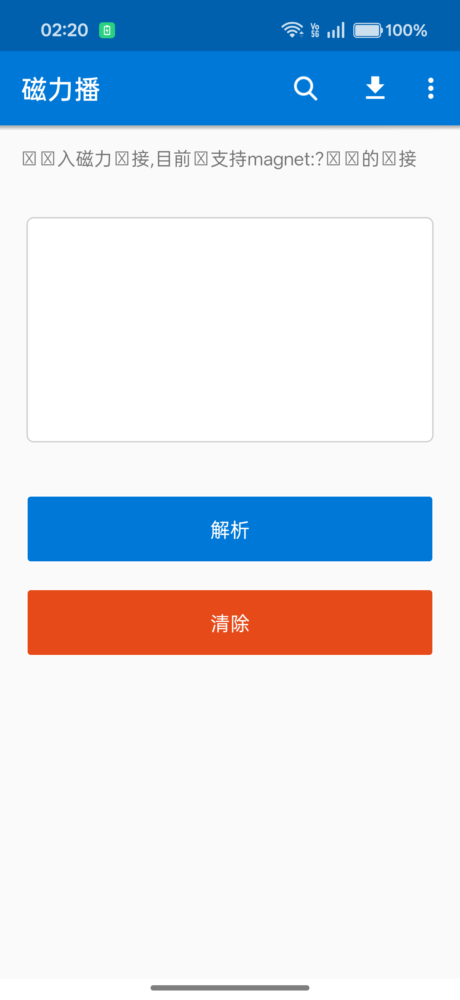

# oos32compat

**为一加 13T / 13S 恢复 32 位应用支持**

**简体中文** | [English](#english)

<p>
  
  
  
  
</p>

> [!WARNING]
> **此模块的 AI 代码含量极高。**
>
> 从脚本到文档，绝大部分是和 AI 一起写的。我不是 Android 系统工程师 ——
> **遇到技术问题别问我。** 我能告诉你怎么刷、怎么验证，但解释不了为什么某些汉字会变成方框。
>
> **能用，但别指望有技术支持。**

> [!CAUTION]
> **只在 Magisk 上实测过，KernelSU 完全没刷过。**
>
> 如果你的机器刷出问题 —— 变砖、开不了机、数据丢失、OTA 失败、保修失效 ——
> **概不负责。刷机有风险，操作前请先备份。**

**完整免责声明见 [DISCLAIMER.md](DISCLAIMER.md)**（纯文本编写，任何 Markdown 阅读器都能正常显示）

---

## 为什么做这个

> 这段是作者自述，不是技术文档。

我原本用一加 13T 跑 ColorOS。用久了越来越烦它的各种限制 —— 预装应用删不掉、系统级推送、
还有那些说不清道不明的"安全策略"。于是我买了一台 15T 当主力，把 13T 刷成了 OxygenOS，
专门当备用机 —— 主要是因为它自带谷歌全家桶，对科学上网的支持也顺一些。

刷完 OOS 才发现问题一大堆：信号不稳、相机功能缺失、公交卡用不了。
好在这些都有社区模块能解决 —— **真心感谢那些做模块的人**，没有他们这台机器根本没法日常用。

真正卡住我的是另一件事。

我在 ColorOS 上一直用一个叫**磁力播**的应用，现在 Play 商店已经下架了。
我用 AI 把它的包拆开分析过 —— 它本质上是迅雷 SDK 的壳，但做了两件聪明事：

1. 把资源渠道导向一些冷门资源站（冷资源、btspread 之类）
2. 客户端不做速度限制

所以它的下载速度比官方迅雷还快。

**问题是：它是 32 位的。**

而 8 Elite 这颗芯片对 32 位的限制非常狠 —— 在 OOS 上，这个应用**连装都装不上**。

我翻遍了中文和英文社区，**几乎没看到有人去解决这个问题**。
大部分讨论的结论都是"用虚拟机吧"，或者"32 位应用就该淘汰"。

所以我就用 AI 啃了这个问题。花了几十块钱的 token 费用，折腾了一整夜，
最后真的跑通了 —— 至少现在这个应用能装上、能正常下载、能播放。

**但它确实和 ColorOS 的 32 位方案还有差距**：部分汉字显示成方框，高负载下音频会失真。
这些我修不了（原因见 [已知问题](#已知问题)），**希望看到这个项目的人能帮忙一起修。**

如果你也用这个模块解决了自己的问题，或者发现了新 bug，欢迎提 Issue。

---

## 这是什么

**一加 13T（PKX110）和它的海外版本 13S（CPH2723）是同一台硬件。**

但出厂软件不同：

| | ColorOS（国行） | OxygenOS（海外） |
|---|---|---|
| 32 位系统库 | ✅ 完整（500+ 个） | ❌ **全部删除** |
| 32 位 zygote | ✅ 存在 | ❌ 无 |
| 32 位 GPU 驱动 | ✅ 完整 | ❌ 无 |
| `ro.zygote` | `zygote64_32` | `zygote64` |

**结果：刷了 OxygenOS 之后，所有 32 位应用都装不上、跑不了。**

这个模块做的只有一件事：**把 ColorOS 固件里的 32 位物料补回 OxygenOS。**

---

## 效果

<table>
<tr>
<td align="center" width="33%">
<br>
<b>32 位应用主界面</b>
</td>
<td align="center" width="33%">
<br>
<b>3D 游戏渲染</b><br>
<sub>282 MB，<code>armeabi</code></sub>
</td>
<td align="center" width="33%">
<br>
<b>视频播放</b>
</td>
</tr>
</table>

实测通过：

| 应用 | ABI | 结果 |
|---|---|---|
| 磁力播放器 | `armeabi-v7a` | ✅ 解析 → 下载 263 MB → 边下边播 |
| Dead Space（EA，282 MB） | `armeabi` | ✅ 3D 场景完整渲染 |
| Flappy Bird | `armeabi-v7a` | ✅ 完整可玩 |
| 天天动听 8.4.1 | `armeabi` | ✅ 界面完整、本地播放 |

> 连 `armeabi`（ARMv5TE，最老的 32 位 ABI）都能跑 3D 游戏。

---

## 前置准备（务必逐条确认）

### 硬件与系统

| 项 | 要求 | 怎么查 |
|---|---|---|
| 机型 | 一加 13T（PKX110）/ 13S（CPH2723） | `getprop ro.product.model` |
| 平台 | 必须是 `sun` | `getprop ro.board.platform` |
| Android | 16（OxygenOS 16） | `getprop ro.build.version.release` |
| Root | **Magisk**（推荐）/ KernelSU（未测试） | Magisk App 能看到"已安装" |

> [!IMPORTANT]
> **平台上不是 `sun` 的机型不要刷。** GPU 驱动和内核不匹配，会导致 zygote 无限重启。

### 必须做的准备

```bash
# 1) 确认 adb 能用
adb devices
# 预期输出：设备序列号    device

# 2) 确认有 root
adb shell su -c 'id'
# 预期输出：uid=0(root) gid=0(root) ...

# 3) 备份现有模块（出问题能恢复）
adb shell su -c 'tar -czf /sdcard/modules_backup.tar.gz -C /data/adb modules'
# 预期：/sdcard/modules_backup.tar.gz 出现

# 4) 记录当前状态（刷完对比用）
adb shell 'getprop ro.product.cpu.abilist; getprop init.svc.zygote_tango; getprop ro.zygote'
# 记录输出，刷完再跑一次对比
```

### 心理准备

- 刷机可能**变砖**（虽然 Magisk 有 bootloop 保护，但不是万无一失）
- 可能**导致 OTA 失败** —— 系统更新前建议先卸载模块
- 可能**影响保修**
- **没有任何技术支持** —— 见开头的声明

---

## 下载

**预制模块**：在 [Releases](../../releases) 页面下载 `oos32compat-v1.0.zip`（约 180 MB）

<details>
<summary><b>想自己从固件提取？</b></summary>

如果你不信任预制的二进制，可以自己从官方 ColorOS 全量 OTA 提取。见下方「方式 B」。

</details>

---

## ⚠️ 刷之前必读

> [!CAUTION]
> **本方案没有隔离。**
>
> 所有 `targetSdk < 23` 的老应用，**安装界面上会一次性列出它声明的全部权限**
> （发短信、录音、定位、读照片位置……）。点「安装」就等于全部同意，
> 之后系统**不会再有任何运行时询问**，`pm revoke` 也无效。
>
> 也就是说：**权限你在安装时确实"同意"了 —— 只是那个列表很容易被无视。**
>
> **只在你自己信任的应用上使用。** 详情见 [DISCLAIMER.md](DISCLAIMER.md) 和 [安全说明](docs/security.md)。

> [!WARNING]
> **预制模块包含厂商二进制文件**（OPPO 的 32 位系统库、Qualcomm 的 GPU 驱动）。
>
> 它们来自官方 ColorOS 固件，仅供个人研究与自用。
> 如需商业使用，请自行从官方固件提取并遵守相应许可。

> [!NOTE]
> 本模块**包含**厂商的二进制翻译器（`/system/bin/tango_translator`）。
> 它来自你的设备固件本身（`ro.vendor.oplus.tango_allow32=true` 说明厂商支持这条路）。
> 如果你的系统里已经有它，模块会覆盖成同一份文件，无副作用。

---

## 安装（以 Magisk 为准）

### 方式 A：刷预制模块

```
第 1 步：把 oos32compat-v1.0.zip 传到手机（USB / 微信文件传输助手都行）
       记住它的路径，比如 /sdcard/Download/oos32compat-v1.0.zip

第 2 步：打开 Magisk App
       底部 → 模块
       → "从本地安装"
       → 找到那个 zip
       → 选中后会自动刷入，看到 "安装完成" 即可

第 3 步：重启手机
       点右下角"重启"，或者长按电源键重启

第 4 步：等待开机
       第一次开机会比平时慢一些（要挂载 1300+ 个文件），耐心等
```

> [!IMPORTANT]
> **如果你之前手动装过旧版模块**（比如 `tango32_cph2723`），
> 先在 Magisk 里把它移除，否则两个模块会同时挂载同一批文件。

### 验证（刷完必做）

```bash
# 1) ABI 属性
adb shell getprop ro.product.cpu.abilist
# 预期：arm64-v8a,armeabi-v7a,armeabi
#   如果只有 arm64-v8a → 模块没生效

# 2) 32 位运行时
adb shell getprop init.svc.zygote_tango
# 预期：running
#   如果是 restarting / stopped → 看下面的「排查」

# 3) SELinux
adb shell getenforce
# 预期：Enforcing

# 4) GPU 驱动
adb shell ls /vendor/lib/egl | wc -l
# 预期：7

# 5) 32 位库总数
adb shell ls /vendor/lib | wc -l
# 预期：520 左右
```

**五条全对 = 安装成功。**

### 方式 B：自己从固件提取

<details>
<summary><b>展开详细步骤</b></summary>

#### B1. 确认固件可用

```bash
adb shell getprop ro.board.platform          # 应为 sun

# 提取 vendor 分区后：
dump.erofs --path=/build.prop --cat vendor.img | grep ro.board.platform   # 必须一致
dump.erofs --path=/lib/egl --ls vendor.img                                # 非空
```

#### B2. 提取物料

```bash
python3 scripts/dump_payload.py vendor
python3 scripts/dump_payload.py system
adb push vendor.img system.img dump.erofs /data/local/tmp/
```

> `dump.erofs` 的路径是**分区根**相对路径：
> vendor 分区 → `/lib/egl`；system 分区 → `/system/etc/...`

| 来源 | 目标 |
|---|---|
| vendor `/lib/egl/*` | `system/vendor/lib/egl/` |
| vendor `/lib/*.so` | `system/vendor/lib/` |
| vendor `/lib/hw/*` | `system/vendor/lib/hw/` |
| system `/system/lib/*.so` | `system/lib/` |

#### B3. 组装并刷入

把仓库 `module/` 的内容 + 提取的文件放进同一目录，打包成 zip，刷入。

> [!IMPORTANT]
> `system/etc/public.libraries.txt` 里加条目**必须带 ABI 标记**：
> ```
> libstats_jni.so              ← ❌ 会让 64 位 zygote 崩溃，无限重启
> libstats_jni.so 32 nopreload ← ✅
> ```

</details>

---

## 使用

### 如何安装 32 位应用

**手机上有文件管理器 + 允许"未知来源安装"的话，直接点 APK 装。**

如果提示"不兼容"或"应用未安装"，用电脑走 adb：

```bash
# 把 APK 传到手机
adb push your-app.apk /data/local/tmp/

# 安装（--bypass-low-target-sdk-block 是关键参数）
adb shell su -c 'pm install -r -t --bypass-low-target-sdk-block /data/local/tmp/your-app.apk'

# 预期输出：Success
```

> [!IMPORTANT]
> **`--bypass-low-target-sdk-block` 必须加。**
> Android 16 要求 `targetSdk ≥ 24`，没有这个参数，2016 年前的应用全部装不上。

### 确认应用真的走了 32 位路径

```bash
# 1) 看 ABI
adb shell dumpsys package <包名> | grep primaryCpuAbi
# 预期：primaryCpuAbi=armeabi-v7a 或 primaryCpuAbi=armeabi
#   如果是 arm64-v8a，说明这个应用有 64 位版本，没走兼容层

# 2) 看父进程
adb shell ps -A | grep -E 'zygote$|<包名>'
# 预期：应用的父进程 PID = zygote_tango 的 PID
```

### 桌面图标不显示？

通过 `adb install` 装的老应用，OPPO 桌面的「全部应用」列表可能不刷新。

**两个办法任选：**

| 办法 | 操作 |
|---|---|
| **重启手机** | 桌面会重建列表，图标就出现了 |
| **不重启** | 桌面下拉 → 搜索框输应用名 → 能直接点开 |

> 这不是 bug，是 OPPO 桌面的缓存问题。应用本身装得好好的。

---

## 已知问题

### 中文部分字形显示为方框

```
"请输入磁力链接" → "□□入磁力□接"
```

**不是配置问题** —— 已逐项验证：字体文件、`fonts.xml`、`libminikin`、`libharfbuzz_ng`
与 ColorOS 固件 **md5 完全一致**，字符串也字节级正确。

**这是翻译层内部的渲染缺陷，用户侧无法修复。** 影响范围：仅部分汉字。

详见 [docs/issues.md](docs/issues.md)。

### 音频在高负载下失真

3D 游戏等高 CPU 场景下，背景音乐会失真（音效正常）。同样是翻译层开销导致。

---

## 卸载

```
Magisk App → 模块 → 找到 oos32compat → 点"移除" → 重启
```

或者用命令行：

```bash
adb shell su -c 'rm -rf /data/adb/modules/oos32compat'
adb reboot
```

> **无限重启了怎么办**：Magisk 的 bootloop 保护会自动禁用所有模块。
> 进 recovery 或 `adb shell`，执行下面前两行再重启：
> ```bash
> adb shell su -c 'rm -f /data/adb/modules/*/disable'
> adb shell su -c 'rm -rf /data/adb/modules/oos32compat'
> adb reboot
> ```

---

## 排查

### 第一步：看 zygote 状态

```bash
adb shell getprop init.svc.zygote_tango
```

- `running` → 正常，问题在别处
- `restarting` → 去看日志（下面）
- `stopped` → 模块没启动它，检查 `service.sh` 有没有执行

### 第二步：看日志找缺哪个库

```bash
adb logcat -d | grep -E 'vndksupport|CANNOT LINK|app_process32.* F'
```

**`vndksupport` 的报错最有价值** —— 它直接告诉你缺哪个文件：

```
E vndksupport: Could not load /vendor/lib/egl/libEGL_adreno.so from sphal namespace:
  dlopen failed: library "XXX.so" not found
```

按提示从固件里补那个库即可。

### 第三步：确认模块真的挂载了

```bash
adb shell su -c 'ls /data/adb/modules/oos32compat/'
adb shell su -c 'cat /data/local/tmp/tango_service.log | tail -20'
```

<details>
<summary><b>其他常见现象</b></summary>

**应用装上了但启动就退出（没有崩溃日志）**
→ 应用自己的 root 检测或签名校验。与兼容层无关，无法绕过。

**能跑 32 位游戏吗**
→ 可以。实测 282 MB 的 Dead Space（`armeabi`）3D 场景完整渲染。但高负载下音频可能失真。

**为什么不用 VMOS / VPhoneOS**

| 方案 | 性能 | 隔离 |
|---|---|---|
| 本模块（原生执行） | 60-80% | ❌ 无 |
| 虚拟机方案 | 20-40% | ✅ 有 |

虚拟机更安全但更慢。**如果你要跑不可信的应用，请用虚拟机。**

</details>

---

## 仓库内容

```
├── README.md              本文（中文）
├── README_EN.md           English version
├── DISCLAIMER.md          完整免责声明（纯文本，任何阅读器可读）
├── docs/
│   ├── build.md           详细构建步骤
│   ├── issues.md          已知问题与排查证据
│   ├── journey.md         技术实现记录（八道关卡）
│   └── security.md        安全模型
├── module/                 Magisk 模块脚本（不含二进制）
│   ├── module.prop
│   ├── post-fs-data.sh     设 ABI 属性
│   ├── service.sh          修 APEX + 启动运行时
│   └── public.libraries.txt
├── scripts/
│   ├── dump_payload.py     从 OTA payload 提取分区
│   ├── apex_overlay.sh     给缺 32 位库的 APEX 打 overlay
│   └── diagnose.sh         环境诊断
└── images/
```

**Releases 里的 zip 含二进制；仓库本身不含。**

---

## Contributors

| | 贡献 |
|---|---|
| **@Tom62** | 项目发起、真机测试、提供 ColorOS 固件、全程决策 |
| **DeepSeek Harness** | 技术方案设计、固件解析、脚本编写、文档撰写、绝大多数调试工作 |
| **豆包** | 前期可行性分析、关键方向判断（如 GPU 驱动来源、平台兼容性） |

> 本项目的代码绝大部分由 AI 生成。**这不是谦虚，是事实** —— 见开头的声明。

> [!NOTE]
> **为什么 GitHub 侧栏的 Contributors 面板只显示 @Tom62？**
>
> 那个面板只统计**有 GitHub 账号**的提交者。DeepSeek Harness 和豆包没有账号，
> 所以不计入面板。
>
> 但它们的贡献是真实的 —— 在 [commits/main](../../commits/main) 页面可以看到
> 两个署名的 commit，作者分别是 DeepSeek Harness 和 Doubao。

---

## 法律与免责

**本项目的定位**

这是一个 ROM 差异补齐工具。一加 13T/13S 的国行版（ColorOS）固件包含完整的 32 位支持物料，
海外版（OxygenOS）将其移除。本项目把这些物料从官方固件中提取并重新组织，
让刷了 OxygenOS 的用户恢复 32 位应用能力。

**关于二进制文件**

Releases 中的预制模块包含来自 **OnePlus 官方 ColorOS 固件**的系统库与 GPU 驱动。
它们的版权归 **OPPO / Qualcomm** 所有。

- 本项目**不主张**对这些二进制的任何权利
- 它们**仅供个人研究与自己设备上的使用**
- 如需商业使用，请自行从官方固件提取并遵守相应许可
- 如版权方认为不妥，请联系删除

**不包含的内容**

- 不包含任何第三方应用（APK）
- 不包含厂商的二进制翻译器（设备自带，无需分发）

**本仓库原创部分**

脚本与文档：**MIT**

**免责声明**

> [!CAUTION]
> **本项目按"现状"提供，不提供任何明示或暗示的担保。**
>
> 使用本模块会修改系统分区挂载、修改系统属性。已确认可能导致的后果包括但不限于：
>
> - **系统无法启动**（可用 Magisk 的 bootloop 保护尝试恢复，但不保证成功）
> - **数据丢失**
> - **系统 OTA 更新失败**
> - **保修失效**
> - **安全问题**（见 [安全说明](docs/security.md)）
>
> **本模块仅在 Magisk 环境下实测过，KernelSU 及其他 root 方案完全未经测试。**
>
> **在非 Magisk 环境下刷入导致的一切后果，作者不承担任何责任。**
>
> **请在充分理解风险的前提下自行决定是否使用。**
>
> **使用即表示你已阅读、理解并接受上述全部风险，并自行承担一切后果。**

---

## 致谢

- erofs-utils — EROFS 镜像解析
- 所有给一加 13T/13S 做 OOS 适配模块的人 —— 你们让这台机器能正常使用
- 所有在 32 位淘汰浪潮里失去应用的人

---

<a id="english"></a>

## English

**Restore 32-bit app support on OnePlus 13T / 13S running OxygenOS**

[简体中文](#oos32compat) | **English**

<p>
  
  
  
  
</p>

> [!WARNING]
> **This project is heavily AI-generated.**
>
> Most of the code and documentation here was written together with an AI.
> The author is not an Android systems engineer — **please don't ask for technical support.**
> It works, but don't expect any.
>
> **Full disclaimer: [DISCLAIMER.md](DISCLAIMER.md)**

> [!CAUTION]
> **Tested on Magisk only. KernelSU has never been tried.**
>
> If your device breaks — bootloop, no boot, data loss, OTA failure, void warranty —
> **you are on your own. Flashing is risky. Back up first.**

---

## Why I built this

> This section is the author's own account, not technical documentation.

I used to run ColorOS on a OnePlus 13T. Over time the restrictions got unbearable —
unremovable preinstalled apps, system-level push notifications, and various "security policies"
that nobody could explain.

So I bought a 15T as my daily driver and flashed the 13T to OxygenOS, keeping it as a backup phone —
mainly because OOS ships with Google services, which works better for my use case.

After flashing OOS, problems appeared: unstable signal, missing camera features, transit card not working.
Fortunately the community had modules for all of those — **genuine thanks to the people who made them**,
without them the phone would be unusable.

The real blocker was something else.

On ColorOS I had been using an app called **磁力播** (a magnet-link downloader), now delisted from the Play Store.
I took the APK apart with an AI to understand it — it's essentially a wrapper around the Xunlei SDK,
with two clever tricks:

1. It routes resource lookups to niche tracker sites
2. It applies no client-side speed cap

That's why it downloads faster than the official Xunlei client.

**The problem: it's 32-bit.**

And the Snapdragon 8 Elite is extremely restrictive about 32-bit — on OOS, **the app couldn't even install**.

I searched Chinese and English communities and **found essentially nobody working on this**.
The usual answers were "use a VM" or "32-bit apps deserve to die".

So I attacked it with an AI. Spent a few dozen RMB on tokens, pulled an all-nighter,
and eventually got it working — at least the app now installs, downloads, and plays.

**But it's still behind what ColorOS can do natively**: some Chinese glyphs render as boxes,
audio distorts under heavy load. I can't fix those (see [Known issues](#known-issues)).
**If you can help fix them, please open an issue.**

---

## What this is

**The OnePlus 13T (PKX110) and its global sibling the 13S (CPH2723) are the same hardware.**

But the firmware differs:

| | ColorOS (China) | OxygenOS (Global) |
|---|---|---|
| 32-bit system libs | ✅ Complete (500+) | ❌ **All removed** |
| 32-bit zygote | ✅ Present | ❌ Absent |
| 32-bit GPU drivers | ✅ Complete | ❌ Absent |
| `ro.zygote` | `zygote64_32` | `zygote64` |

**Result: after flashing OxygenOS, no 32-bit app can be installed or run.**

This module does exactly one thing: **it puts the 32-bit material from the ColorOS firmware back into OxygenOS.**

---

## Results

<table>
<tr>
<td align="center" width="33%">
<br>
<b>32-bit app main UI</b>
</td>
<td align="center" width="33%">
<br>
<b>3D game rendering</b><br>
<sub>282 MB, <code>armeabi</code></sub>
</td>
<td align="center" width="33%">
<br>
<b>Video playback</b>
</td>
</tr>
</table>

Verified working:

| App | ABI | Result |
|---|---|---|
| Magnet downloader | `armeabi-v7a` | ✅ Parse → download 263 MB → stream-and-play |
| Dead Space (EA, 282 MB) | `armeabi` | ✅ Full 3D scene rendering |
| Flappy Bird | `armeabi-v7a` | ✅ Fully playable |
| TTPod 8.4.1 | `armeabi` | ✅ Complete UI, local playback |

> Even `armeabi` (ARMv5TE, the oldest 32-bit ABI) can run a 3D game.

---

## Prerequisites (check every item)

### Hardware & system

| Item | Requirement | How to check |
|---|---|---|
| Device | OnePlus 13T (PKX110) / 13S (CPH2723) | `getprop ro.product.model` |
| Platform | Must be `sun` | `getprop ro.board.platform` |
| Android | 16 (OxygenOS 16) | `getprop ro.build.version.release` |
| Root | **Magisk** (recommended) / KernelSU (untested) | Magisk App shows "Installed" |

> [!IMPORTANT]
> **Do not flash on devices whose platform is not `sun`.** The GPU drivers won't match the kernel
> and the zygote will restart forever.

### Required preparation

```bash
# 1) adb works
adb devices
# Expected: <serial>    device

# 2) root works
adb shell su -c 'id'
# Expected: uid=0(root) gid=0(root) ...

# 3) back up existing modules
adb shell su -c 'tar -czf /sdcard/modules_backup.tar.gz -C /data/adb modules'
# Expected: /sdcard/modules_backup.tar.gz appears

# 4) record current state (for comparison)
adb shell 'getprop ro.product.cpu.abilist; getprop init.svc.zygote_tango; getprop ro.zygote'
```

### Mental preparation

- Flashing may **brick** the device (Magisk's bootloop protection helps, but isn't guaranteed)
- May **break OTA updates** — uninstall the module before updating
- May **void your warranty**
- **No technical support whatsoever** — see the notice at the top

---

## Download

**Prebuilt module**: grab `oos32compat-v1.0.zip` (~180 MB) from the [Releases](../../releases) page.

<details>
<summary><b>Prefer to extract from firmware yourself?</b></summary>

If you don't trust the prebuilt binaries, you can extract everything from the official ColorOS OTA.
See "Option B" below.

</details>

---

## Before you flash

> [!CAUTION]
> **There is no isolation.**
>
> Every `targetSdk < 23` app will have **all of its declared permissions listed at once on the install screen**
> (SMS, microphone, camera, location, photo location...). Tapping "Install" grants them all.
> After that the system **never asks again**, and `pm revoke` doesn't work either.
>
> In other words: **you did "consent" at install time — the list is just easy to ignore.**
>
> **Only use this with apps you trust.** See [DISCLAIMER.md](DISCLAIMER.md) and [security notes](docs/security.md).

> [!WARNING]
> **The prebuilt module contains vendor binaries** (OPPO's 32-bit system libraries, Qualcomm's GPU drivers).
> They come from official ColorOS firmware and are provided for personal research and self-use only.
> For commercial use, extract them yourself from official firmware and comply with the relevant licenses.

> [!NOTE]
> This module **includes** the vendor's binary translator (`/system/bin/tango_translator`).
> It comes from your device's own firmware (`ro.vendor.oplus.tango_allow32=true` means the vendor supports this path).
> If your system already has it, the module overrides it with the identical file — harmless.

---

## Installation (Magisk)

### Option A: flash the prebuilt module

```
Step 1: copy oos32compat-v1.0.zip to your phone
        note its path, e.g. /sdcard/Download/oos32compat-v1.0.zip

Step 2: open Magisk
        bottom bar → Modules
        → "Install from storage"
        → pick the zip
        → it flashes automatically; wait for "Installation done"

Step 3: reboot
Step 4: wait — first boot is slower (1300+ files get mounted)
```

> [!IMPORTANT]
> **If you previously installed an older module manually** (e.g. `tango32_cph2723`),
> remove it in Magisk first — otherwise both modules will mount the same files.

### Verify

```bash
# 1) ABI properties
adb shell getprop ro.product.cpu.abilist
# Expected: arm64-v8a,armeabi-v7a,armeabi

# 2) 32-bit runtime
adb shell getprop init.svc.zygote_tango
# Expected: running

# 3) SELinux
adb shell getenforce
# Expected: Enforcing

# 4) GPU drivers
adb shell ls /vendor/lib/egl | wc -l
# Expected: 7

# 5) total 32-bit libs
adb shell ls /vendor/lib | wc -l
# Expected: ~520
```

**All five correct = installation succeeded.**

### Option B: extract from firmware yourself

<details>
<summary><b>Expand for detailed steps</b></summary>

#### B1. Verify the firmware is usable

```bash
adb shell getprop ro.board.platform          # must be sun

dump.erofs --path=/build.prop --cat vendor.img | grep ro.board.platform   # must match
dump.erofs --path=/lib/egl --ls vendor.img                                # must be non-empty
```

#### B2. Extract the material

```bash
python3 scripts/dump_payload.py vendor
python3 scripts/dump_payload.py system
adb push vendor.img system.img dump.erofs /data/local/tmp/
```

> `dump.erofs` paths are **relative to the partition root**:
> vendor → `/lib/egl`; system → `/system/etc/...`

| Source | Destination |
|---|---|
| vendor `/lib/egl/*` | `system/vendor/lib/egl/` |
| vendor `/lib/*.so` | `system/vendor/lib/` |
| vendor `/lib/hw/*` | `system/vendor/lib/hw/` |
| system `/system/lib/*.so` | `system/lib/` |

#### B3. Assemble and flash

Put the contents of `module/` plus your extracted files into one directory, zip it, flash it.

> [!IMPORTANT]
> Entries added to `system/etc/public.libraries.txt` **must carry an ABI marker**:
> ```
> libstats_jni.so              ← ❌ crashes the 64-bit zygote, infinite reboot
> libstats_jni.so 32 nopreload ← ✅
> ```

</details>

---

## Usage

### Installing a 32-bit app

**If your phone has a file manager and "unknown sources" is enabled, just tap the APK.**

If it says "incompatible" or "app not installed", use adb:

```bash
adb push your-app.apk /data/local/tmp/

adb shell su -c 'pm install -r -t --bypass-low-target-sdk-block /data/local/tmp/your-app.apk'

# Expected: Success
```

> [!IMPORTANT]
> **`--bypass-low-target-sdk-block` is mandatory.**
> Android 16 requires `targetSdk ≥ 24`; without this flag, anything from before 2016 refuses to install.

### Confirm it really runs as 32-bit

```bash
# 1) ABI
adb shell dumpsys package <pkg> | grep primaryCpuAbi
# Expected: primaryCpuAbi=armeabi-v7a  or  armeabi
# If it says arm64-v8a, the app has a 64-bit build and isn't using the compat layer

# 2) parent process
adb shell ps -A | grep -E 'zygote$|<pkg>'
# The app's parent PID should equal zygote_tango's PID
```

### Icon not showing in the launcher?

Apps installed via `adb install` may not appear in the OPPO launcher's "All apps" list — it caches.

| Fix | How |
|---|---|
| **Reboot** | The launcher rebuilds its list |
| **No reboot** | Pull down on the home screen → search box → type the app name |

> This is a launcher cache issue, not a bug in the app. It's installed fine.

---

## Known issues

### Some Chinese glyphs render as boxes

```
"请输入磁力链接" → "□□入磁力□接"
```

**Not a configuration problem** — verified item by item: font files, `fonts.xml`, `libminikin`,
`libharfbuzz_ng` are **byte-identical (md5) to the ColorOS firmware**, and the strings are byte-correct too.

**This is a rendering defect inside the translation layer; it cannot be fixed from userspace.**
Only a subset of CJK characters is affected.

See [docs/issues.md](docs/issues.md) for the full investigation.

### Audio distorts under heavy load

In high-CPU scenarios (3D games), background music distorts while sound effects stay clean.
Same root cause: translation overhead.

---

## Uninstall

```
Magisk App → Modules → oos32compat → Remove → reboot
```

Or from the command line:

```bash
adb shell su -c 'rm -rf /data/adb/modules/oos32compat'
adb reboot
```

> **Bootloop?** Magisk's bootloop protection will disable all modules automatically.
> From recovery or `adb shell`:
> ```bash
> adb shell su -c 'rm -f /data/adb/modules/*/disable'
> adb shell su -c 'rm -rf /data/adb/modules/oos32compat'
> adb reboot
> ```

---

## Troubleshooting

### Step 1: check the zygote

```bash
adb shell getprop init.svc.zygote_tango
```

- `running` → fine, look elsewhere
- `restarting` → check logs (below)
- `stopped` → the module isn't starting it; check whether `service.sh` ran

### Step 2: find the missing library

```bash
adb logcat -d | grep -E 'vndksupport|CANNOT LINK|app_process32.* F'
```

**`vndksupport` errors are the most useful** — they name the exact missing file:

```
E vndksupport: Could not load /vendor/lib/egl/libEGL_adreno.so from sphal namespace:
  dlopen failed: library "XXX.so" not found
```

Extract that library from the firmware and add it.

### Step 3: confirm the module actually mounted

```bash
adb shell su -c 'ls /data/adb/modules/oos32compat/'
adb shell su -c 'cat /data/local/tmp/tango_service.log | tail -20'
```

<details>
<summary><b>Other common symptoms</b></summary>

**App installs but exits immediately (no crash log)**
→ The app's own root detection or signature check. Unrelated to this module; cannot be bypassed.

**Can it run 32-bit games?**
→ Yes. A 282 MB `armeabi` game (Dead Space) renders its full 3D scene. Audio may distort under load.

**Why not VMOS / VPhoneOS?**

| Approach | Performance | Isolation |
|---|---|---|
| This module (native execution) | 60-80% | ❌ None |
| Virtual machine | 20-40% | ✅ Yes |

VMs are safer but much slower. **If you need to run untrusted apps, use a VM.**

</details>

---

## Repository layout

```
├── README.md              Chinese version
├── README_EN.md           This file (English)
├── DISCLAIMER.md          Full disclaimer (plain text)
├── docs/
│   ├── build.md           Detailed build steps
│   ├── issues.md          Known issues and investigation evidence
│   ├── journey.md         Technical log (the eight walls)
│   └── security.md        Security model
├── module/                Magisk module scripts (no binaries)
│   ├── module.prop
│   ├── post-fs-data.sh    Sets ABI properties
│   ├── service.sh         Fixes APEX, starts the runtime
│   └── public.libraries.txt
├── scripts/
│   ├── dump_payload.py    Extract partitions from an OTA payload
│   ├── apex_overlay.sh    Overlay APEXes that lack 32-bit libs
│   └── diagnose.sh        Environment diagnostics
└── images/
```

**The Release zip contains binaries; the repository itself does not.**

---

## Contributors

| | Contribution |
|---|---|
| **@Tom62** | Project initiator, on-device testing, provided the ColorOS firmware, all decisions |
| **DeepSeek Harness** | Technical design, firmware parsing, scripts, documentation, most of the debugging |
| **Doubao (豆包)** | Early feasibility analysis and key directional judgements |

> Most of the code here is AI-generated. That is a statement of fact, not modesty — see the notice at the top.

> [!NOTE]
> **Why does the Contributors sidebar only show @Tom62?**
>
> That panel only counts committers who have a GitHub **account**. DeepSeek Harness and Doubao
> don't have accounts, so they aren't counted.
>
> Their contributions are real — see [commits/main](../../commits/main) for the two signed commits
> authored by `DeepSeek Harness` and `Doubao`.

---

## Legal & disclaimer

**What this project is**

A ROM-difference patcher. The China firmware (ColorOS) for the OnePlus 13T/13S contains complete 32-bit
support material; the global firmware (OxygenOS) removes it. This project extracts that material from
the official firmware and reorganizes it, so users who flashed OxygenOS regain 32-bit app support.

**About the binaries**

The prebuilt module in Releases contains system libraries and GPU drivers originating from
**official OnePlus ColorOS firmware**. Copyright belongs to **OPPO / Qualcomm**.

- This project **claims no rights** over those binaries
- They are **for personal research and use on your own device only**
- For commercial use, extract them yourself from official firmware and comply with the relevant licenses
- If a rights holder objects, contact us and it will be removed

**Not included**

- No third-party applications (APKs)

**Original work**

Scripts and documentation: **MIT**

**Disclaimer**

> [!CAUTION]
> **This project is provided "as is", without warranty of any kind, express or implied.**
>
> Using this module modifies system partition mounts and system properties. Confirmed possible consequences
> include but are not limited to:
>
> - **System fails to boot** (Magisk's bootloop protection may help, but is not guaranteed)
> - **Data loss**
> - **OTA updates fail**
> - **Warranty void**
> - **Security implications** (see [security notes](docs/security.md))
>
> **This module has only been tested under Magisk. KernelSU and any other root solution are completely untested.**
>
> **The author accepts no responsibility for any consequence of flashing in a non-Magisk environment.**
>
> **Use at your own risk, after fully understanding the risks.**
>
> **By using this, you confirm you have read, understood and accepted all of the above.**

---

## Credits

- erofs-utils — EROFS image parsing
- Everyone who made OOS adaptation modules for the OnePlus 13T/13S — you made this phone usable
- Everyone who lost their apps to the 32-bit purge
