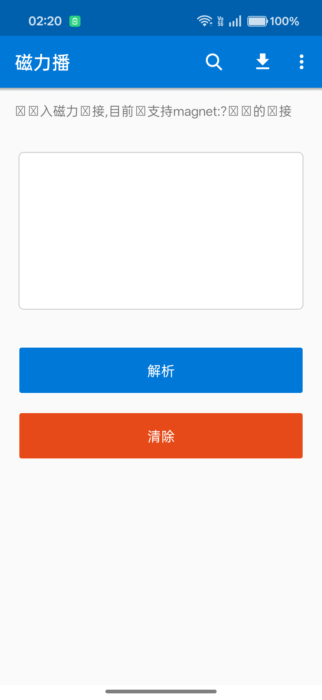

# oos32compat

**Restore 32-bit app support on OnePlus 13T / 13S running OxygenOS**

简体中文 | **English** *(you are here)*

<p>
  
  
  
  
</p>

> [!WARNING]
> **This project is heavily AI-generated.**
>
> Most of the code and documentation here was written together with an AI.
> The author is not an Android systems engineer — **please don't ask for technical support.**
> It works, but don't expect any.
>
> **Full disclaimer: [DISCLAIMER.md](DISCLAIMER.md)**

> [!CAUTION]
> **Tested on Magisk only. KernelSU has never been tried.**
>
> If your device breaks — bootloop, no boot, data loss, OTA failure, void warranty —
> **you are on your own. Flashing is risky. Back up first.**

---

## Why I built this

> This section is the author's own account, not technical documentation.

I used to run ColorOS on a OnePlus 13T. Over time the restrictions got unbearable —
unremovable preinstalled apps, system-level push notifications, and various "security policies"
that nobody could explain.

So I bought a 15T as my daily driver and flashed the 13T to OxygenOS, keeping it as a backup phone —
mainly because OOS ships with Google services, which works better for my use case.

After flashing OOS, problems appeared: unstable signal, missing camera features, transit card not working.
Fortunately the community had modules for all of those — **genuine thanks to the people who made them**,
without them the phone would be unusable.

The real blocker was something else.

On ColorOS I had been using an app called **磁力播** (a magnet-link downloader), now delisted from the Play Store.
I took the APK apart with an AI to understand it — it's essentially a wrapper around the Xunlei SDK,
with two clever tricks:

1. It routes resource lookups to niche tracker sites
2. It applies no client-side speed cap

That's why it downloads faster than the official Xunlei client.

**The problem: it's 32-bit.**

And the Snapdragon 8 Elite is extremely restrictive about 32-bit — on OOS, **the app couldn't even install**.

I searched Chinese and English communities and **found essentially nobody working on this**.
The usual answers were "use a VM" or "32-bit apps deserve to die".

So I attacked it with an AI. Spent a few dozen RMB on tokens, pulled an all-nighter,
and eventually got it working — at least the app now installs, downloads, and plays.

**But it's still behind what ColorOS can do natively**: some Chinese glyphs render as boxes,
audio distorts under heavy load. I can't fix those (see [Known issues](#known-issues)).
**If you can help fix them, please open an issue.**

---

## What this is

**The OnePlus 13T (PKX110) and its global sibling the 13S (CPH2723) are the same hardware.**

But the firmware differs:

| | ColorOS (China) | OxygenOS (Global) |
|---|---|---|
| 32-bit system libs | ✅ Complete (500+) | ❌ **All removed** |
| 32-bit zygote | ✅ Present | ❌ Absent |
| 32-bit GPU drivers | ✅ Complete | ❌ Absent |
| `ro.zygote` | `zygote64_32` | `zygote64` |

**Result: after flashing OxygenOS, no 32-bit app can be installed or run.**

This module does exactly one thing: **it puts the 32-bit material from the ColorOS firmware back into OxygenOS.**

---

## Results

<table>
<tr>
<td align="center" width="33%">
<br>
<b>32-bit app main UI</b>
</td>
<td align="center" width="33%">
<br>
<b>3D game rendering</b><br>
<sub>282 MB, <code>armeabi</code></sub>
</td>
<td align="center" width="33%">
<br>
<b>Video playback</b>
</td>
</tr>
</table>

Verified working:

| App | ABI | Result |
|---|---|---|
| Magnet downloader | `armeabi-v7a` | ✅ Parse → download 263 MB → stream-and-play |
| Dead Space (EA, 282 MB) | `armeabi` | ✅ Full 3D scene rendering |
| Flappy Bird | `armeabi-v7a` | ✅ Fully playable |
| TTPod 8.4.1 | `armeabi` | ✅ Complete UI, local playback |

> Even `armeabi` (ARMv5TE, the oldest 32-bit ABI) can run a 3D game.

---

## Prerequisites (check every item)

### Hardware & system

| Item | Requirement | How to check |
|---|---|---|
| Device | OnePlus 13T (PKX110) / 13S (CPH2723) | `getprop ro.product.model` |
| Platform | Must be `sun` | `getprop ro.board.platform` |
| Android | 16 (OxygenOS 16) | `getprop ro.build.version.release` |
| Root | **Magisk** (recommended) / KernelSU (untested) | Magisk App shows "Installed" |

> [!IMPORTANT]
> **Do not flash on devices whose platform is not `sun`.** The GPU drivers won't match the kernel
> and the zygote will restart forever.

### Required preparation

```bash
# 1) adb works
adb devices
# Expected: <serial>    device

# 2) root works
adb shell su -c 'id'
# Expected: uid=0(root) gid=0(root) ...

# 3) back up existing modules
adb shell su -c 'tar -czf /sdcard/modules_backup.tar.gz -C /data/adb modules'
# Expected: /sdcard/modules_backup.tar.gz appears

# 4) record current state (for comparison)
adb shell 'getprop ro.product.cpu.abilist; getprop init.svc.zygote_tango; getprop ro.zygote'
```

### Mental preparation

- Flashing may **brick** the device (Magisk's bootloop protection helps, but isn't guaranteed)
- May **break OTA updates** — uninstall the module before updating
- May **void your warranty**
- **No technical support whatsoever** — see the notice at the top

---

## Download

**Prebuilt module**: grab `oos32compat-v1.0.zip` (~180 MB) from the [Releases](../../releases) page.

<details>
<summary><b>Prefer to extract from firmware yourself?</b></summary>

If you don't trust the prebuilt binaries, you can extract everything from the official ColorOS OTA.
See "Option B" below.

</details>

---

## Before you flash

> [!CAUTION]
> **There is no isolation.**
>
> Every `targetSdk < 23` app will have **all of its declared permissions listed at once on the install screen**
> (SMS, microphone, camera, location, photo location...). Tapping "Install" grants them all.
> After that the system **never asks again**, and `pm revoke` doesn't work either.
>
> In other words: **you did "consent" at install time — the list is just easy to ignore.**
>
> **Only use this with apps you trust.** See [DISCLAIMER.md](DISCLAIMER.md) and [security notes](docs/security.md).

> [!WARNING]
> **The prebuilt module contains vendor binaries** (OPPO's 32-bit system libraries, Qualcomm's GPU drivers).
> They come from official ColorOS firmware and are provided for personal research and self-use only.
> For commercial use, extract them yourself from official firmware and comply with the relevant licenses.

> [!NOTE]
> This module **includes** the vendor's binary translator (`/system/bin/tango_translator`).
> It comes from your device's own firmware (`ro.vendor.oplus.tango_allow32=true` means the vendor supports this path).
> If your system already has it, the module overrides it with the identical file — harmless.

---

## Installation (Magisk)

### Option A: flash the prebuilt module

```
Step 1: copy oos32compat-v1.0.zip to your phone
        note its path, e.g. /sdcard/Download/oos32compat-v1.0.zip

Step 2: open Magisk
        bottom bar → Modules
        → "Install from storage"
        → pick the zip
        → it flashes automatically; wait for "Installation done"

Step 3: reboot
Step 4: wait — first boot is slower (1300+ files get mounted)
```

> [!IMPORTANT]
> **If you previously installed an older module manually** (e.g. `tango32_cph2723`),
> remove it in Magisk first — otherwise both modules will mount the same files.

### Verify

```bash
# 1) ABI properties
adb shell getprop ro.product.cpu.abilist
# Expected: arm64-v8a,armeabi-v7a,armeabi

# 2) 32-bit runtime
adb shell getprop init.svc.zygote_tango
# Expected: running

# 3) SELinux
adb shell getenforce
# Expected: Enforcing

# 4) GPU drivers
adb shell ls /vendor/lib/egl | wc -l
# Expected: 7

# 5) total 32-bit libs
adb shell ls /vendor/lib | wc -l
# Expected: ~520
```

**All five correct = installation succeeded.**

### Option B: extract from firmware yourself

<details>
<summary><b>Expand for detailed steps</b></summary>

#### B1. Verify the firmware is usable

```bash
adb shell getprop ro.board.platform          # must be sun

dump.erofs --path=/build.prop --cat vendor.img | grep ro.board.platform   # must match
dump.erofs --path=/lib/egl --ls vendor.img                                # must be non-empty
```

#### B2. Extract the material

```bash
python3 scripts/dump_payload.py vendor
python3 scripts/dump_payload.py system
adb push vendor.img system.img dump.erofs /data/local/tmp/
```

> `dump.erofs` paths are **relative to the partition root**:
> vendor → `/lib/egl`; system → `/system/etc/...`

| Source | Destination |
|---|---|
| vendor `/lib/egl/*` | `system/vendor/lib/egl/` |
| vendor `/lib/*.so` | `system/vendor/lib/` |
| vendor `/lib/hw/*` | `system/vendor/lib/hw/` |
| system `/system/lib/*.so` | `system/lib/` |

#### B3. Assemble and flash

Put the contents of `module/` plus your extracted files into one directory, zip it, flash it.

> [!IMPORTANT]
> Entries added to `system/etc/public.libraries.txt` **must carry an ABI marker**:
> ```
> libstats_jni.so              ← ❌ crashes the 64-bit zygote, infinite reboot
> libstats_jni.so 32 nopreload ← ✅
> ```

</details>

---

## Usage

### Installing a 32-bit app

**If your phone has a file manager and "unknown sources" is enabled, just tap the APK.**

If it says "incompatible" or "app not installed", use adb:

```bash
adb push your-app.apk /data/local/tmp/

adb shell su -c 'pm install -r -t --bypass-low-target-sdk-block /data/local/tmp/your-app.apk'

# Expected: Success
```

> [!IMPORTANT]
> **`--bypass-low-target-sdk-block` is mandatory.**
> Android 16 requires `targetSdk ≥ 24`; without this flag, anything from before 2016 refuses to install.

### Confirm it really runs as 32-bit

```bash
# 1) ABI
adb shell dumpsys package <pkg> | grep primaryCpuAbi
# Expected: primaryCpuAbi=armeabi-v7a  or  armeabi
# If it says arm64-v8a, the app has a 64-bit build and isn't using the compat layer

# 2) parent process
adb shell ps -A | grep -E 'zygote$|<pkg>'
# The app's parent PID should equal zygote_tango's PID
```

### Icon not showing in the launcher?

Apps installed via `adb install` may not appear in the OPPO launcher's "All apps" list — it caches.

| Fix | How |
|---|---|
| **Reboot** | The launcher rebuilds its list |
| **No reboot** | Pull down on the home screen → search box → type the app name |

> This is a launcher cache issue, not a bug in the app. It's installed fine.

---

## Known issues

### Some Chinese glyphs render as boxes

```
"请输入磁力链接" → "□□入磁力□接"
```

**Not a configuration problem** — verified item by item: font files, `fonts.xml`, `libminikin`,
`libharfbuzz_ng` are **byte-identical (md5) to the ColorOS firmware**, and the strings are byte-correct too.

**This is a rendering defect inside the translation layer; it cannot be fixed from userspace.**
Only a subset of CJK characters is affected.

See [docs/issues.md](docs/issues.md) for the full investigation.

### Audio distorts under heavy load

In high-CPU scenarios (3D games), background music distorts while sound effects stay clean.
Same root cause: translation overhead.

---

## Uninstall

```
Magisk App → Modules → oos32compat → Remove → reboot
```

Or from the command line:

```bash
adb shell su -c 'rm -rf /data/adb/modules/oos32compat'
adb reboot
```

> **Bootloop?** Magisk's bootloop protection will disable all modules automatically.
> From recovery or `adb shell`:
> ```bash
> adb shell su -c 'rm -f /data/adb/modules/*/disable'
> adb shell su -c 'rm -rf /data/adb/modules/oos32compat'
> adb reboot
> ```

---

## Troubleshooting

### Step 1: check the zygote

```bash
adb shell getprop init.svc.zygote_tango
```

- `running` → fine, look elsewhere
- `restarting` → check logs (below)
- `stopped` → the module isn't starting it; check whether `service.sh` ran

### Step 2: find the missing library

```bash
adb logcat -d | grep -E 'vndksupport|CANNOT LINK|app_process32.* F'
```

**`vndksupport` errors are the most useful** — they name the exact missing file:

```
E vndksupport: Could not load /vendor/lib/egl/libEGL_adreno.so from sphal namespace:
  dlopen failed: library "XXX.so" not found
```

Extract that library from the firmware and add it.

### Step 3: confirm the module actually mounted

```bash
adb shell su -c 'ls /data/adb/modules/oos32compat/'
adb shell su -c 'cat /data/local/tmp/tango_service.log | tail -20'
```

<details>
<summary><b>Other common symptoms</b></summary>

**App installs but exits immediately (no crash log)**
→ The app's own root detection or signature check. Unrelated to this module; cannot be bypassed.

**Can it run 32-bit games?**
→ Yes. A 282 MB `armeabi` game (Dead Space) renders its full 3D scene. Audio may distort under load.

**Why not VMOS / VPhoneOS?**

| Approach | Performance | Isolation |
|---|---|---|
| This module (native execution) | 60-80% | ❌ None |
| Virtual machine | 20-40% | ✅ Yes |

VMs are safer but much slower. **If you need to run untrusted apps, use a VM.**

</details>

---

## Repository layout

```
├── README.md              Chinese version
├── README_EN.md           This file (English)
├── DISCLAIMER.md          Full disclaimer (plain text)
├── docs/
│   ├── build.md           Detailed build steps
│   ├── issues.md          Known issues and investigation evidence
│   ├── journey.md         Technical log (the eight walls)
│   └── security.md        Security model
├── module/                Magisk module scripts (no binaries)
│   ├── module.prop
│   ├── post-fs-data.sh    Sets ABI properties
│   ├── service.sh         Fixes APEX, starts the runtime
│   └── public.libraries.txt
├── scripts/
│   ├── dump_payload.py    Extract partitions from an OTA payload
│   ├── apex_overlay.sh    Overlay APEXes that lack 32-bit libs
│   └── diagnose.sh        Environment diagnostics
└── images/
```

**The Release zip contains binaries; the repository itself does not.**

---

## Contributors

| | Contribution |
|---|---|
| **@Tom62** | Project initiator, on-device testing, provided the ColorOS firmware, all decisions |
| **DeepSeek Harness** | Technical design, firmware parsing, scripts, documentation, most of the debugging |
| **Doubao (豆包)** | Early feasibility analysis and key directional judgements |

> Most of the code here is AI-generated. That is a statement of fact, not modesty — see the notice at the top.

---

## Legal & disclaimer

**What this project is**

A ROM-difference patcher. The China firmware (ColorOS) for the OnePlus 13T/13S contains complete 32-bit
support material; the global firmware (OxygenOS) removes it. This project extracts that material from
the official firmware and reorganizes it, so users who flashed OxygenOS regain 32-bit app support.

**About the binaries**

The prebuilt module in Releases contains system libraries and GPU drivers originating from
**official OnePlus ColorOS firmware**. Copyright belongs to **OPPO / Qualcomm**.

- This project **claims no rights** over those binaries
- They are **for personal research and use on your own device only**
- For commercial use, extract them yourself from official firmware and comply with the relevant licenses
- If a rights holder objects, contact us and it will be removed

**Not included**

- No third-party applications (APKs)

**Original work**

Scripts and documentation: **MIT**

**Disclaimer**

> [!CAUTION]
> **This project is provided "as is", without warranty of any kind, express or implied.**
>
> Using this module modifies system partition mounts and system properties. Confirmed possible consequences
> include but are not limited to:
>
> - **System fails to boot** (Magisk's bootloop protection may help, but is not guaranteed)
> - **Data loss**
> - **OTA updates fail**
> - **Warranty void**
> - **Security implications** (see [security notes](docs/security.md))
>
> **This module has only been tested under Magisk. KernelSU and any other root solution are completely untested.**
>
> **The author accepts no responsibility for any consequence of flashing in a non-Magisk environment.**
>
> **Use at your own risk, after fully understanding the risks.**
>
> **By using this, you confirm you have read, understood and accepted all of the above.**

---

## Credits

- erofs-utils — EROFS image parsing
- Everyone who made OOS adaptation modules for the OnePlus 13T/13S — you made this phone usable
- Everyone who lost their apps to the 32-bit purge
